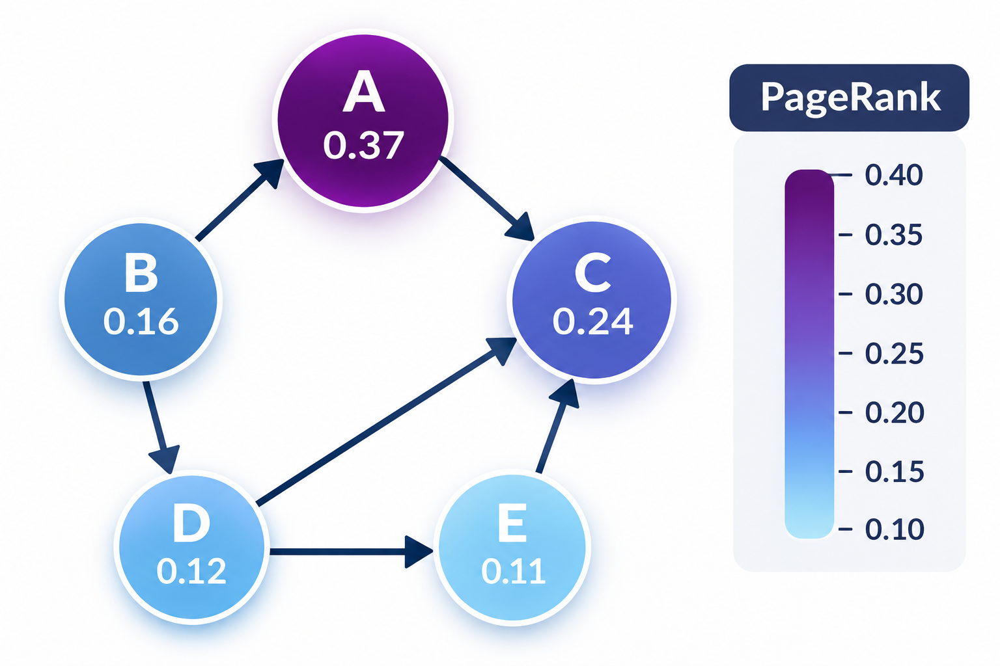

# Introduction

## Overview

🔗 **Course website:** Moodle

📚 **Books:**

- **A Book on C**, Edition 4. by Al Kelley and Ira Pohl. Addison-Wesley
- **Python data science handbook** VanderPlas O'Reilly

## Course Admin

$\textbf{Final Grade} = 0.5 \times \text{Exam} + 0.5 \times \text{Project}$

$\mathrm{HW}_0$–$\mathrm{HW}_2$ (optional)

**Submission:** In pairs (all the assignments including project)

**Project Deadline:** 11.4.27

**Communication:** Moodle Forums

📅 **Office Hour:** See In Moodle

💻 **Official Course Env:** Linux (Ubuntu)

## Course objective

- Large scale programming
- Efficient computation
- Real world application
- Core programming in C that is interfaced from a Python pipeline that uses the
  data science libs.

## Project

Task: Page Rank

## Course Schedule

Tuesday class, 12:00–14:00. Homework is optional. A question mark in the
schedule is still open.

| Date | Week | Subject | Homework |
| --- | --- | --- | --- |
| 20.10.26 | 1 | [DevEnv + Docker](weeks/01-devenv.md) | — |
| 27.10.26 | — | Election Day | — |
| 3.11.26 | 2 | [Project](weeks/03-project.md) | — |
| 10.11.26 | 3 | [C basics](weeks/04-c-basics-w3.md) | HW0 |
| 17.11.26 | 4 | [C basics](weeks/05-c-basics-w4.md) | — |
| 24.11.26 | 5 | [C basics](weeks/06-c-basics-w5.md) | HW1 |
| 1.12.26 | 6 | [C basics](weeks/07-c-basics-w6.md) | — |
| 8.12.26 | 7 | [C basics](weeks/08-c-basics-w7.md) | — |
| 15.12.26 | 8 | [C-Python + Python Data science libraries](weeks/09-cpython.md) | — |
| 22.12.26 | 9 | [Python Data science libraries](weeks/10-python-ds.md) | HW2 |
| 29.12.26 | 10 | [Large scale computing](weeks/11-large-scale.md) | — |
| 5.1.27 | 11 | [Databases — SQL / noSQL / Postgres](weeks/12-databases.md) | — |
| 12.1.27 | 12 | [Parallel/distributed — CUDA + docker compose](weeks/13-parallel.md) | — |
| 18.1.27 | 13 | [C Tutorial](weeks/14-c-tutorial.md) | — |
